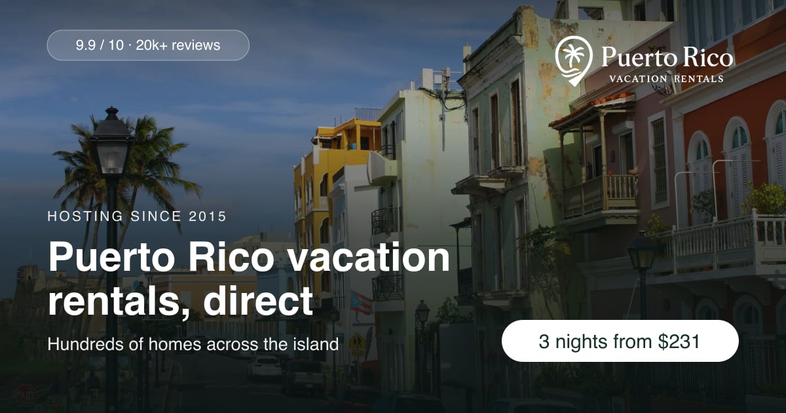
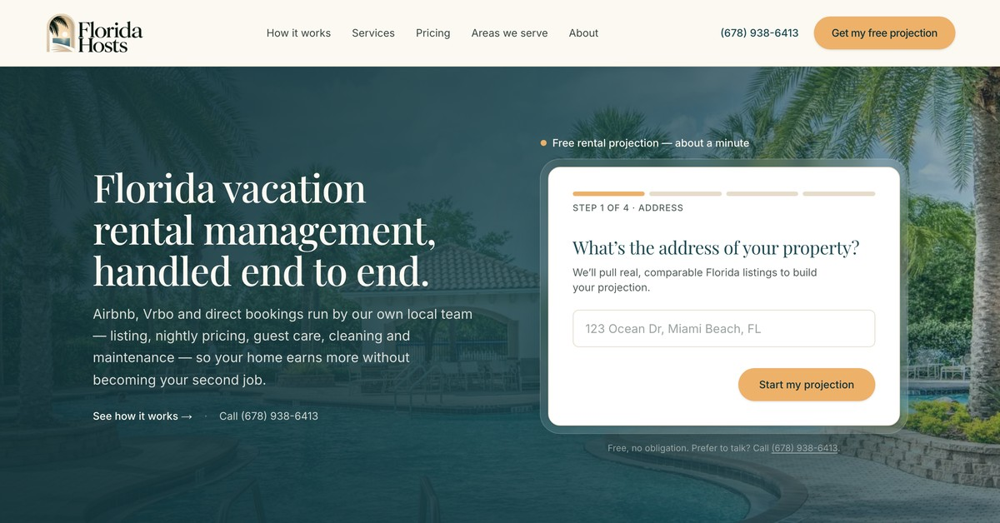

# Property platforms

**The direct-booking and owner-acquisition platforms I designed for the rental businesses I led: much more than websites, they book guests, win owners and feed every lead straight to the team.**

## RentInPR.com

The direct-booking platform I designed and built from scratch for Palm Heaven's 100+ vacation homes in Puerto Rico: live availability and prices, the all-in price up front, and none of the 15 to 20% fees the big platforms charge. **$20K+ a year** in platform fees avoided.

## FloridaHosts.com

The platform for Florida Hosts, a statewide vacation rental management brand. Owners start a free rental projection with just an address, across nine Florida regions from the Keys to the Panhandle.

## SSMproperty.com
[SSMproperty.com](https://ssmproperty.com) is Silverstone Management's owner-acquisition platform: service and city pages across Atlanta and North Georgia, and an instant rental-income projection that sends each owner lead straight to the team.

## ATLStay.com
[ATLStay.com](https://atlstay.com) is the platform behind Silverstone Management's short-term rental brand in Atlanta: 900+ pages and a lead desk that saves every owner inquiry and alerts the team the moment it comes in.

> **About the code:** these platforms are private business software, so this repository holds the case study only.

[Bardia Zadeh](https://bardia.dev) · Georgia Tech M.S. in Computer Science (HCI)
